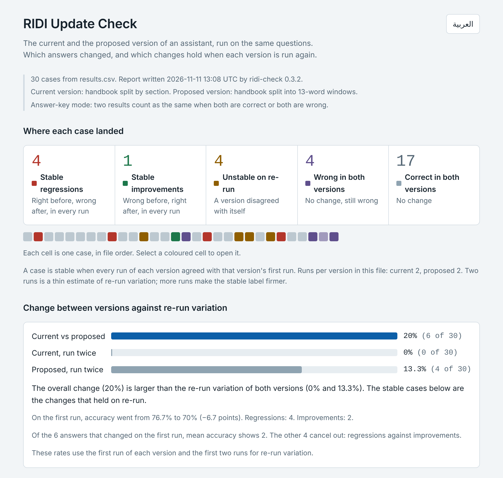
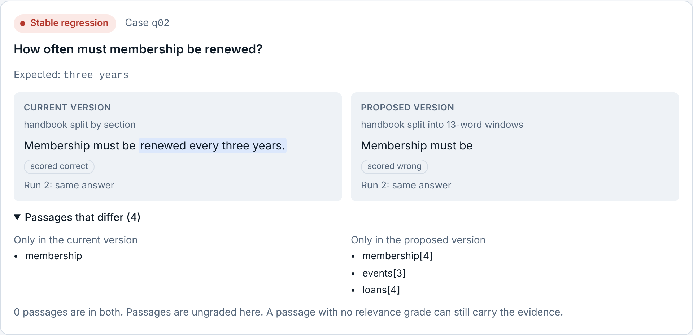

# ridi-check

**See what a model or prompt update really changed in your assistant's answers, before you ship it.**

[](https://github.com/adeebnoor/ridi-check/actions/workflows/tests.yml)
[](https://github.com/adeebnoor/ridi-check/blob/main/LICENSE)
[](https://github.com/adeebnoor/ridi-check/blob/main/pyproject.toml)

A new model or an edited prompt can change what your assistant or agent answers without anyone noticing:
average accuracy barely moves while individual answers flip. ridi-check runs the old and the new version on
the same questions, more than once, and shows which answers changed and which of those changes hold on
re-run. You need no test set, no answer key and no model judge.

**Try it in your browser, with nothing to install:** [adeebnoor.github.io/ridi-check](https://adeebnoor.github.io/ridi-check/).
It opens on two synthetic examples: a library handbook, and made-up medicines where mean accuracy rises
while three answers break in every run.



[What you will see](#what-you-will-see) · [Who it is for](#who-it-is-for) · [Start in one minute](#start-in-one-minute) ·
[Use it in CI](#use-it-in-ci) · [Connect your assistant](#connect-your-assistant) · [FAQ](#faq) ·
[Roadmap](#roadmap) · [Limitations](#limitations) · [Reference](https://github.com/adeebnoor/ridi-check/blob/main/docs/REFERENCE.md)

## What you will see

**In your terminal or CI log**, `ridi-check gate` lists every answer that was right and is now wrong in
every run, and exits 1 so the pipeline stops:

```text
ridi-check gate: ridi-demo/ridi-out/results.csv, 30 cases, answer-key mode
stable_regression  case q02
stable_regression  case q09
stable_regression  case q18
stable_regression  case q25
counts: stable_regression=4 stable_improvement=1 regression_unconfirmed=0 improvement_unconfirmed=0 unstable=4 wrong_both=4 correct_both=17 incomplete=0
stable regressions: 4 (limit 0) - over the limit
gate: a limit was exceeded
```

**In the report**, each changed case shows the question, both answers, what the second run gave and the
passages only one version used:



Every question ends in one group:

| Group | Meaning |
|---|---|
| Stable regression | right before, wrong after, in every run: an answer your update broke |
| Stable improvement | wrong before, right after, in every run |
| Stable change | no answer key: a different answer in every run, for you to judge |
| Unstable on re-run | a version disagreed with itself, so the difference is not evidence about the update |
| Wrong in both | no change, still wrong; listed separately |

The report is one self-contained HTML file. It works offline, on a phone, in light and dark, in English and
Arabic. The numbers above come from `ridi-check demo`, which uses synthetic data.

## Who it is for

- **You are about to swap the model, edit the prompt or change retrieval** and want to know which answers
  move, not only whether an average moved.
- **You have questions but no answer key.** The report shows what changed; you judge only the changes that
  held on re-run.
- **You want a CI check** that fails when an answer that was right becomes wrong in every run.
- **You only have answers in a spreadsheet.** The [browser version](https://adeebnoor.github.io/ridi-check/) reads pasted cells and
  needs no install.

It is **not** for proving that answers are correct or that a system is ready to deploy, or for explaining
why an answer changed. Agents that use tools or keep state can be wrapped, but that has not been tried on a
production agent. See
[Limitations](#limitations) and the [use cases](https://github.com/adeebnoor/ridi-check/blob/main/docs/USE_CASES.md).

## Start in one minute

Python 3.10 or later, no dependencies. The demo needs no network and no API key; its data is synthetic.

```bash
pip install ridi-check
```

```bash
ridi-check demo --open
```

Then check your own assistant:

```bash
ridi-check init my-check
```

It writes `questions.csv`, `my_assistant.py` (one function to fill in), `ridi-check.json` and
`ASK_YOUR_AI.md`, a prompt that lets your AI coding assistant do the wiring. In that folder, try five
questions with `ridi-check run --limit 5`, then run everything with `ridi-check run`. The
[user guide](https://github.com/adeebnoor/ridi-check/blob/main/docs/USER_GUIDE.md) walks through each step and how to read the report.

**No install at all:** open the [browser version](https://adeebnoor.github.io/ridi-check/) and paste your results (CSV
text or cells copied from a spreadsheet). Your data stays in the page: it sends nothing anywhere. To use it
offline, download the single file [web/ridi-update-check.html](https://github.com/adeebnoor/ridi-check/blob/main/web/ridi-update-check.html).

**Development version:** `pip install git+https://github.com/adeebnoor/ridi-check` installs the latest commit instead of the
latest release.

## Use it in CI

```yaml
- run: pip install ridi-check
- run: ridi-check run --config ridi-check.json     # calls both versions, writes ridi-out/results.csv
- run: ridi-check gate ridi-out/results.csv        # exits 1 on a stable regression
```

A complete GitHub Actions workflow to copy: [examples/ci/ridi-check.yml](https://github.com/adeebnoor/ridi-check/blob/main/examples/ci/ridi-check.yml).
`gate` prints counts and the offending cases; it never prints a verdict about your system. By default it
does not count answers that did not hold on re-run; where a wrong answer is costly, add `--max-unstable 0`.
Limits such as `--max-stable-regressions 2` are in the [reference](https://github.com/adeebnoor/ridi-check/blob/main/docs/REFERENCE.md#ridi-check-gate-resultscsv).

## Connect your assistant

ridi-check has no model provider built in. Your assistant is the system under test, reached through one
function:

```python
def answer(question: str) -> dict:
    return {"answer": "text", "context": ["doc-12", "doc-40"]}   # context is optional
```

| Your assistant is… | Pass it as |
|---|---|
| importable from Python | `python:module:function` |
| a program in any language | `command:<shell command>` (question on stdin, JSON or text on stdout) |
| an HTTP service | `http://…`, or a JSON file that describes the request and the reply |

Ready-made examples in [examples/adapters](https://github.com/adeebnoor/ridi-check/blob/main/examples/adapters/README.md): an OpenAI-compatible HTTP
API (no code), the Claude API through its official SDK, and a shell command with `curl`. Each reads its key
from an environment variable and is tested against a local stand-in server.

The two versions should differ only in what the update changes. Details:
[developer guide](https://github.com/adeebnoor/ridi-check/blob/main/docs/DEVELOPER_GUIDE.md#connecting-an-assistant).

## FAQ

**Do I need a test set or an answer key?** No. Without an `expected` column the report shows which answers
differ and you judge only the stable changes. With one, it speaks of regressions and improvements.

**Does my data go anywhere?** No. ridi-check calls only your assistant and writes local files. The report
and the browser version make no network request.

**Does it use a model to judge answers?** No. A judge adds its own error. Scoring is exact match after
normalisation, or a function you write.

**How many questions and runs?** 30 to 100 real user questions is a good first set. Two runs per version is
the minimum for the stable label; use more when the decision is expensive. Calls = questions × 2 × runs.

**Almost everything is "unstable" or "changed". Why?** Your assistant words the same answer differently each
time. Add `expected` answers with a scoring function, or use `--similarity 0.9`.

**Which providers and frameworks does it support?** Any. It talks to a function, a command or an HTTP
endpoint, not to a provider.

**Can I use it on an agent?** Yes, wrapped as one function: a question or a whole scripted conversation goes
in, the final answer comes out, and the tool calls are returned as `context`, so the report shows which
calls only one version made. [examples/adapters](https://github.com/adeebnoor/ridi-check/blob/main/examples/adapters/README.md#an-agent-with-tools-and-memory)
has a working stand-in agent. It has not been tried on a production agent yet.

## Roadmap

No dates and no promises; this is what is planned and what is not.

- **Done:** a release on [PyPI](https://pypi.org/project/ridi-check/), a hosted browser version, adapter
  examples for common APIs.
- **Next:** fixes and examples that real use asks for. Nothing else is scheduled.
- **Being considered:** intervals for the rates, multi-turn conversations, tool-using agents, more report
  languages.
- **Not planned:** model-based judging, or any hosted service that receives your data.

Tell us what you need in an [issue](https://github.com/adeebnoor/ridi-check/issues).

## Limitations

- It finds change, not correctness. A version that is wrong the same way every time looks stable, and
  cases wrong in both versions are listed separately.
- Without an answer key or your judgment, a difference is a change, not a regression.
- Passages are shown as they differ and are not graded; an ungraded passage can still carry the evidence.
- Two runs is a thin estimate of re-run variation. More runs make the stable label firmer.
- It is not a readiness or safety certificate. No output says a system is fit to deploy; the gate prints
  counts and the decision stays yours.
- Agents that use tools or keep state have a documented pattern and a stand-in example, but the tool has
  not been tried on a production agent. Not in this version: model-based judging, statistical tests.

## Documentation

- [User guide](https://github.com/adeebnoor/ridi-check/blob/main/docs/USER_GUIDE.md): step by step, and how to read the report
- [Use cases](https://github.com/adeebnoor/ridi-check/blob/main/docs/USE_CASES.md): thirteen situations and how to set each one up
- [Developer guide](https://github.com/adeebnoor/ridi-check/blob/main/docs/DEVELOPER_GUIDE.md): adapters, files, CI, library use
- [Reference](https://github.com/adeebnoor/ridi-check/blob/main/docs/REFERENCE.md): every command and option, `results.csv`, the labelling rules
- بالعربية: [دليل الاستخدام](https://github.com/adeebnoor/ridi-check/blob/main/docs/USER_GUIDE.ar.md) · [حالات الاستخدام](https://github.com/adeebnoor/ridi-check/blob/main/docs/USE_CASES.ar.md) ·
  [دليل المطورين](https://github.com/adeebnoor/ridi-check/blob/main/docs/DEVELOPER_GUIDE.ar.md)

ridi-check follows the RIDI method.

## Contributing

Bug reports, questions and pull requests are welcome: see [CONTRIBUTING.md](https://github.com/adeebnoor/ridi-check/blob/main/CONTRIBUTING.md) and the
[changelog](https://github.com/adeebnoor/ridi-check/blob/main/CHANGELOG.md). Everyone taking part follows the
[code of conduct](https://github.com/adeebnoor/ridi-check/blob/main/CODE_OF_CONDUCT.md). Report a vulnerability privately, as
[SECURITY.md](https://github.com/adeebnoor/ridi-check/blob/main/SECURITY.md) describes.

## Licence

MIT. See [LICENSE](https://github.com/adeebnoor/ridi-check/blob/main/LICENSE).
